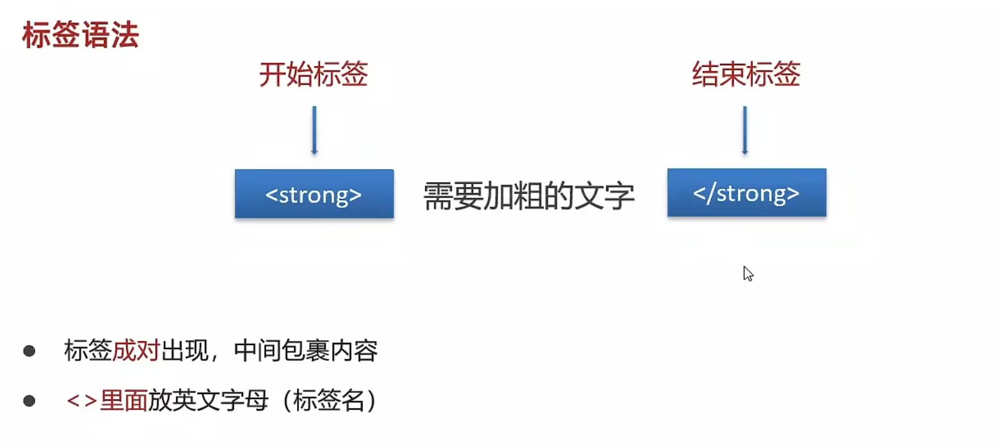
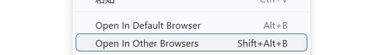
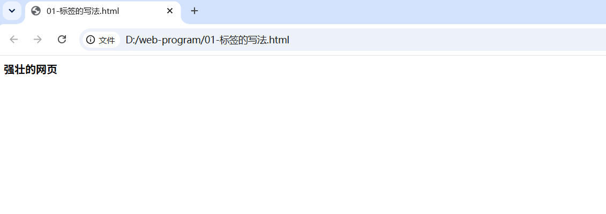
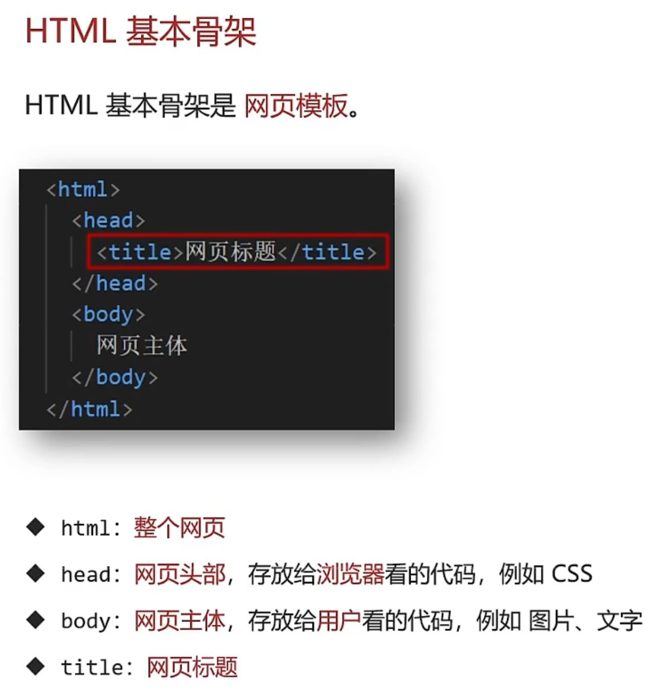
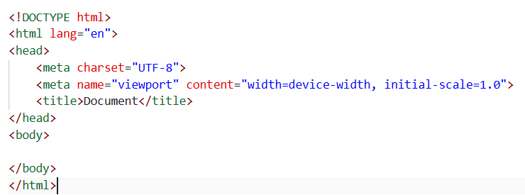
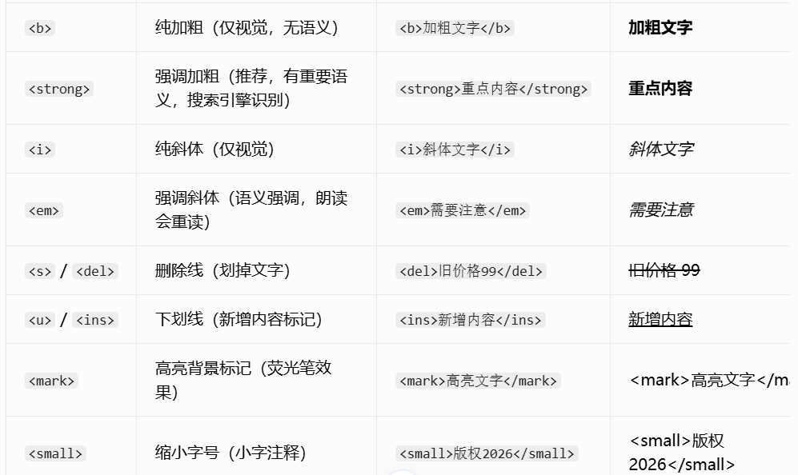
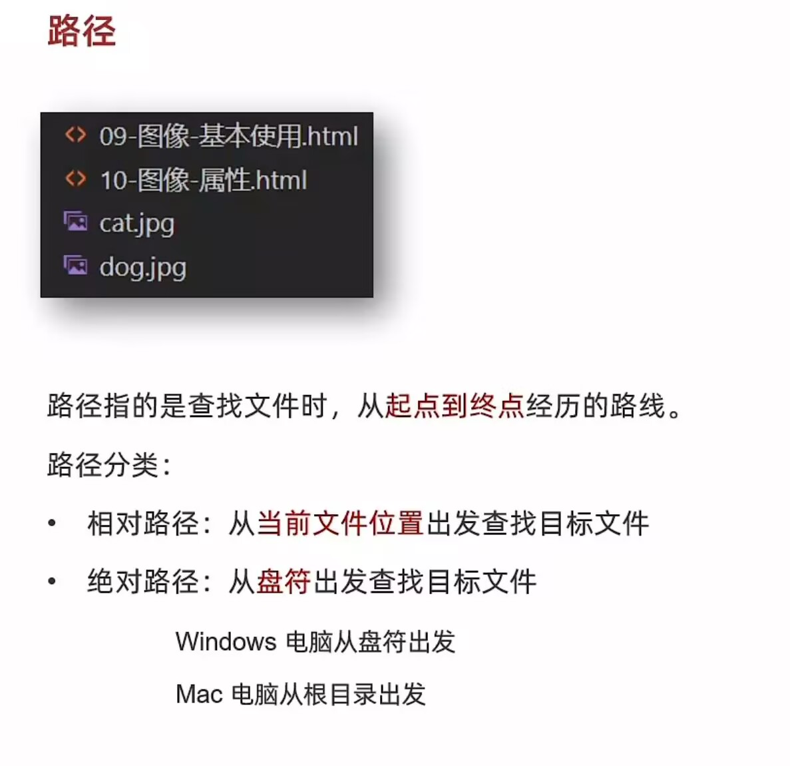
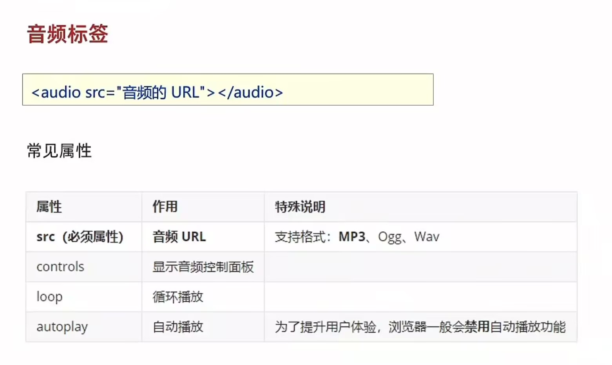
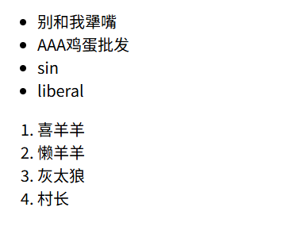
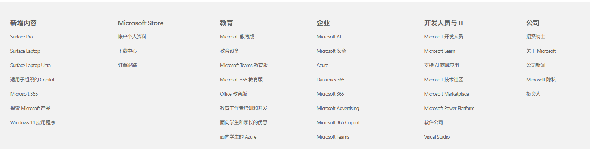

# HTML
HTML的全称为超文本标记语言，是一种标记语言。它包括一系列标签，通过这些标签可以将网络上的文档格式统一，使分散的Internet资源连接为一个逻辑整体。HTML文本是由HTML命令组成的描述性文本，HTML命令可以说明文字，图形、动画、声音、表格、链接等。 
超文本是一种组织信息的方式，它通过超级链接方法将文本中的文字、图表与其他信息媒体相关联。这些相互关联的信息媒体可能在同一文本中，也可能是其他文件，或是地理位置相距遥远的某台计算机上的文件。这种组织信息方式将分布在不同位置的信息资源用随机方式进行连接，为人们查找，检索信息提供方便。   

HTML是一种基础技术，常与CSS、JavaScript一起被众多网站用于设计网页、网页应用程序以及移动应用程序的用户界面 。网页浏览器可以读取HTML文件，并将其渲染成可视化网页。HTML描述了一个网站的结构语义随着线索的呈现，使之成为一种标记语言而非编程语言。
HTML元素是构建网站的基石。HTML允许嵌入图像与对象，并且可以用于创建交互式表单，它被用来结构化信息——例如标题、段落和列表等等，也可用来在一定程度上描述文档的外观和语义。HTML的语言形式为尖括号包围的HTML元素（如<html>），浏览器使用HTML标签和脚本来诠释网页内容，但不会将它们显示在页面上。

>**一定要保存  ctrl+s**

>超文本：链接  
https://markdown.com.cn/basic-syntax/   markdown的语法网站

>标记：标签（带尖括号的文本）

独立预览窗口
>快捷键：Ctrl+Shift+V，单独弹出预览页面查看图片。

运行html文件：右键   然后看到open in browsers点击进入浏览器  

**开始标签< >  结束标签</ >**
拓展：  
**双标签：成对出现的标签**
**单标签：只有开始标签，没有结束标签**   不需要包裹内容，只需要效果
  换行

水平线

## html骨架

>快速生成html基本骨架  

>在html文件中  !(英文)配合Enter/Tab键  

## 标签的关系  

>作用：明确代码的书写位置  
>父子关系（嵌套关系）
>兄弟关系（并列关系）
向前缩进 shift + tab  
向后缩进  tab 

## 注释
<!-- ... -->注释不会在浏览器中显示
ctrl + /  添加/删除注释

## 文本格式化标签

## 图像标签
作用：在网页中插入图片

属性：src 图片源  
 alt 替代文本  
  width 宽度 / height 高度  
    loading="lazy" 懒加载  
     decoding="async" 异步解码  
       title 鼠标悬浮提示

## 路径

 .  当前文件所在的文件夹  

 .. 当前文件上一级文件夹  

 /  进入某个文件夹里面  
 
绝对路径的应用场景 友情链接  

 建议链接使用  / 

 ## 超链接
 点击跳转到其他页面 
 
<a href="https://baike.baidu.com/" target="_blank">跳转到百度百科</a>
 
<a href="./01-标签的写法.html" target="_blank">别这么说</a>
 
<!-- target="_blank  实现新的打开，旧的还在 -->
<a href="#" target="_blank">不要点</a>
 
<!-- #  代表空的  开发初期不知道跳转地址 -->

## 音频标签

## 列表
作用：布局内容排列整齐
无序列表：布局整齐的不需要规定顺序的区域  
标签：ul嵌套li，ul是无序列表，li是列表条目  
有序列表：布局整齐的需要规定顺序的区域 
标签：ol嵌套li，ol是有序列表，li是列表条目

定义列表：用在网页底部，类似于服务中心

